<h1 align="center">Hi, I'm Sher Muhammad Iqbal</h1>
<h3 align="center">Frontend-Focused Full-Stack Engineer · Angular, React & Next.js</h3>

  Building scalable, performant web apps in Angular and React, backed by NestJS APIs, real-time systems, and AI features. 
  2+ years of professional experience · Currently at <strong>HS Technologies</strong> · BS CS @ UET Lahore (2027)

  
  
  
  

---

### What I'm Doing

Building production **Angular 21** frontends in an Nx monorepo at **HS Technologies**: shared component libraries, payment and wallet flows, and order tracking screens

Shipping **React** and **Next.js** apps in TypeScript and Tailwind, from booking platforms to a browser-based AI voice agent

Building real-time UIs on WebSockets and WebRTC: live video, live transcripts, and event dashboards

Backing the frontend with **NestJS** and Node.js APIs, so I can own a feature from the UI down to the database

**Ask me about:** Angular, React/Next.js, TypeScript, component architecture, real-time UIs, and NestJS

---

### Tech Stack

**Frontend (core)**

  
  
  
  
  
  
  
  

`Angular 15–21` `React` `Next.js` `TypeScript` `Tailwind CSS` `Redux Toolkit` `PrimeNG` `Nx Monorepo` `RxJS` `Zustand` `Responsive UI` `Real-time UIs`

**Backend & Data (also strong)**

  
  
  
  
  
  
  

**Tooling & Delivery**

  
  

Git · CI/CD · Docker · Nx · PM2

**AI / Real-time**

  
  
  
  

**Also used:** FFmpeg · MediaMTX · React Native · Kotlin · Electron · Deno · FastAPI · C# · PHP · MySQL · MongoDB · Firebase · Supabase · Stripe · Twilio · SignalR · RxJS · Zustand

---

### Featured Projects

**Buy4Me — Cross-Border E-Commerce** *(frontend: Angular 21)*
`Angular 21` `TypeScript` `Nx Monorepo` `NestJS 11` `MySQL` `Prisma` `Stripe` `Qdrant`
Production platform for the Azerbaijan market. A 4-app Nx monorepo with shared Angular libraries, payment and multi-currency wallet screens, order and shipment tracking, and Qdrant-powered semantic product search. Deployed on a VPS with PM2 + CI/CD.

**PM Suite — Project Management Platform**
`Angular` `TypeScript` `Deno` `PostgreSQL`
Full-stack PM platform with Kanban boards, a Notion-style document editor, real-time messaging, and KPI dashboards. Built as an offline-capable PWA with JWT auth and RBAC.

**CallDraft — AI Voice Agent** *(personal project)*
`Next.js` `TypeScript` `OpenAI Realtime API` `WebRTC`
Browser-based AI voice agent with live speech-to-speech conversation at sub-800ms latency, using ephemeral-token WebRTC auth, a live transcript, and a real-time latency indicator.

**VXS — Vehicle Surveillance & Access Control** *(company project)*
`NestJS` `TypeScript` `PostgreSQL` `TypeORM` `Socket.IO` `FFmpeg` `MediaMTX` `WebRTC`
Contributed to a 33-module NestJS backend for enterprise vehicle monitoring across a distributed VXS + DPU architecture. Owned the live-streaming pipeline (FFmpeg → MediaMTX → WebRTC/WHEP) with automatic reconnection and stuck-stream detection, plus a real-time WebSocket gateway for ANPR events and alarms.

**Real-Time Billing Engine**
`Node.js` `Express` `TypeORM` `PostgreSQL` `Socket.IO`
Server-authoritative medical billing system with pessimistic locking for concurrent session safety, doctor-client queue matching, and heartbeat-based session monitoring.

---

### GitHub Stats

  
  

  

